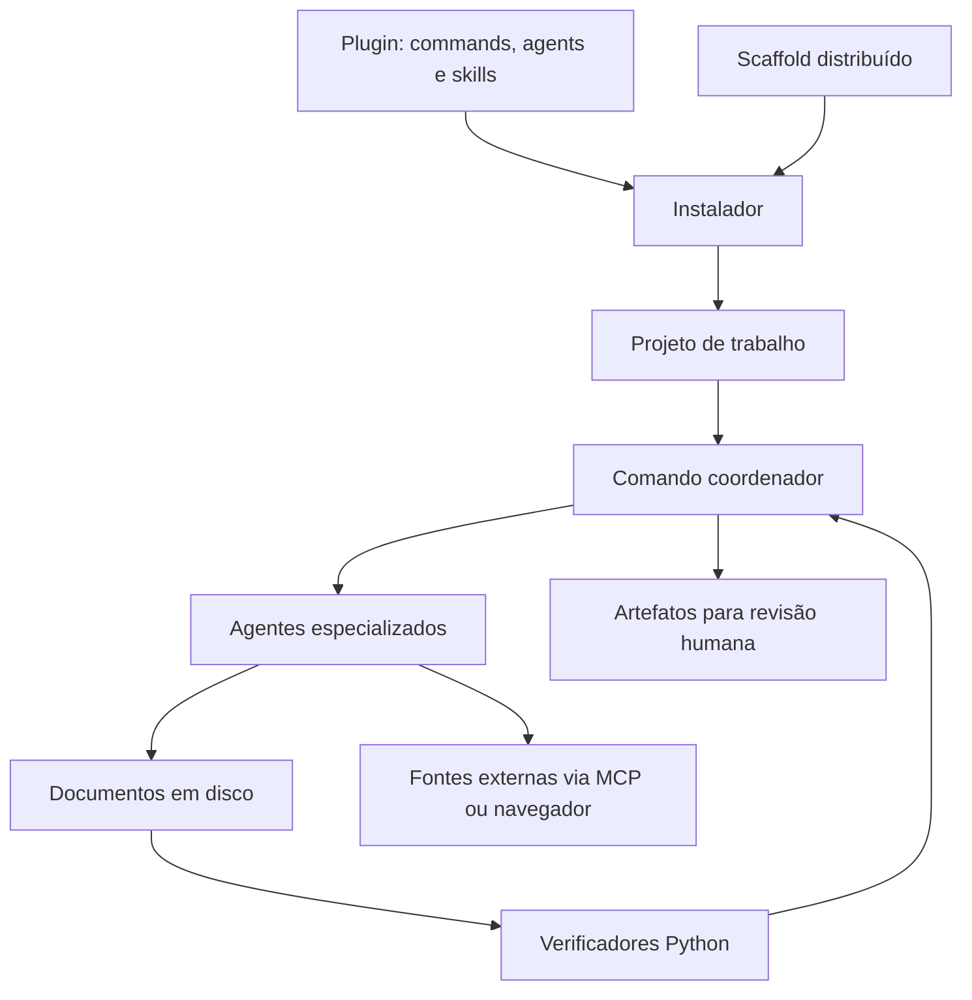

# Arquitetura

[Voltar ao índice](README.md)

## Duas camadas

O **plugin** contém ferramentas para criar e instalar componentes. O **projeto de trabalho** recebe os componentes de domínio e armazena os processos e resultados.

## Responsabilidades

| Diretório ou arquivo | Responsabilidade |
| --- | --- |
| `.claude-plugin/plugin.json` | Identificador, versão, descrição e origem do plugin |
| `commands/` | Instalação e criação de agentes, skills, equipes e orquestradores |
| `agents/` | Geradores e validadores usados pelas ferramentas de criação |
| `skills/` | Instruções, referências e modelos para criar componentes |
| `scaffold/commands/` | Fluxos judiciais distribuídos |
| `scaffold/agents/` | Agentes de extração, análise, pesquisa, redação, revisão, listas e debate |
| `scaffold/skills/` | Capacidades de domínio, incluindo scripts executáveis |
| `scaffold/mcp-servers/` | Servidores Python de pesquisa externa |
| `scaffold/scripts/` | Verificação, consolidação e ingestão de artefatos |
| `scaffold/project-*` | Modelos dos arquivos da raiz do projeto instalado |
| `spec/` | Contratos, modelos e documentação histórica do framework |

## Coordenação e contratos

O padrão chamado **orquestrador cego** separa a coordenação da produção de conteúdo. O coordenador fornece caminhos e objetivos aos agentes; cada agente lê suas entradas, grava o resultado e devolve um estado curto. Scripts verificam os critérios necessários para avançar.

Os verificadores conferem aspectos como existência do arquivo, tamanho mínimo, marcadores, seções e determinados campos estruturados. Eles tornam a execução rastreável, mas não tornam determinística a geração de texto pelo modelo nem validam integralmente o mérito jurídico.

O motor genérico está em [verificar_pipeline.py](../scaffold/scripts/verificar_pipeline.py). A sentença possui um [verificador próprio](../scaffold/scripts/verificar_sentenca.py), com lógica de triagem e escalada.

## Fluxo principal de sentença

1. Varrer os artefatos existentes e identificar etapas pendentes.
2. Produzir linha do tempo e relatório.
3. Executar triagem cognitiva e registrar a rota em arquivo.
4. Executar pesquisa e/ou debate probatório quando a rota exigir.
5. Produzir análise e fundamentação, incluindo eventual escalada prevista pelo contrato.
6. Reunir os textos por script e executar as conferências finais.

Os parciais de fontes são reunidos por `merge_fontes.py`. O `verificar_citacoes.py` compara citações com o registro de fontes; isso depende da qualidade e autenticidade dos trechos coletados. O `merge_sentenca.py` reúne relatório e fundamentação sem geração de texto por modelo.

## Versões e legado

O manifesto informa a versão **1.3.0 do plugin**. O fluxo principal de sentença se identifica como **v3.1**. As versões do plugin, das especificações, dos agentes e dos fluxos são independentes.

Há documentos e comandos herdados com convenções anteriores, inclusive validação por leitura de marcadores e caminhos de outro ambiente. Para manutenção, confronte a documentação conceitual com o comando e o verificador efetivamente utilizados. O [README de especificações](../spec/README.md) contém uma nota sobre essa transição.

A fase 1 acrescenta testes automatizados em `tests/test_instalacao_jt.py` para perfis, instalação e importação. Ainda não há fluxo de integração contínua versionado. Consulte [desenvolvimento](desenvolvimento.md) para as verificações locais e os limites de cada uma.
